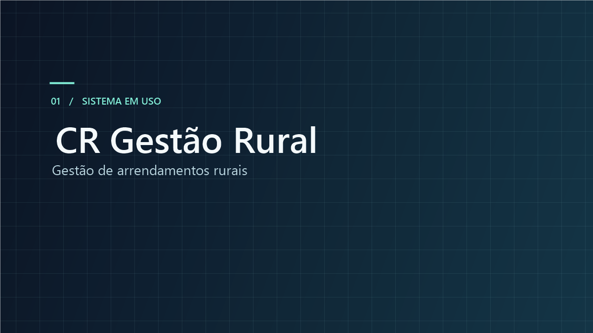
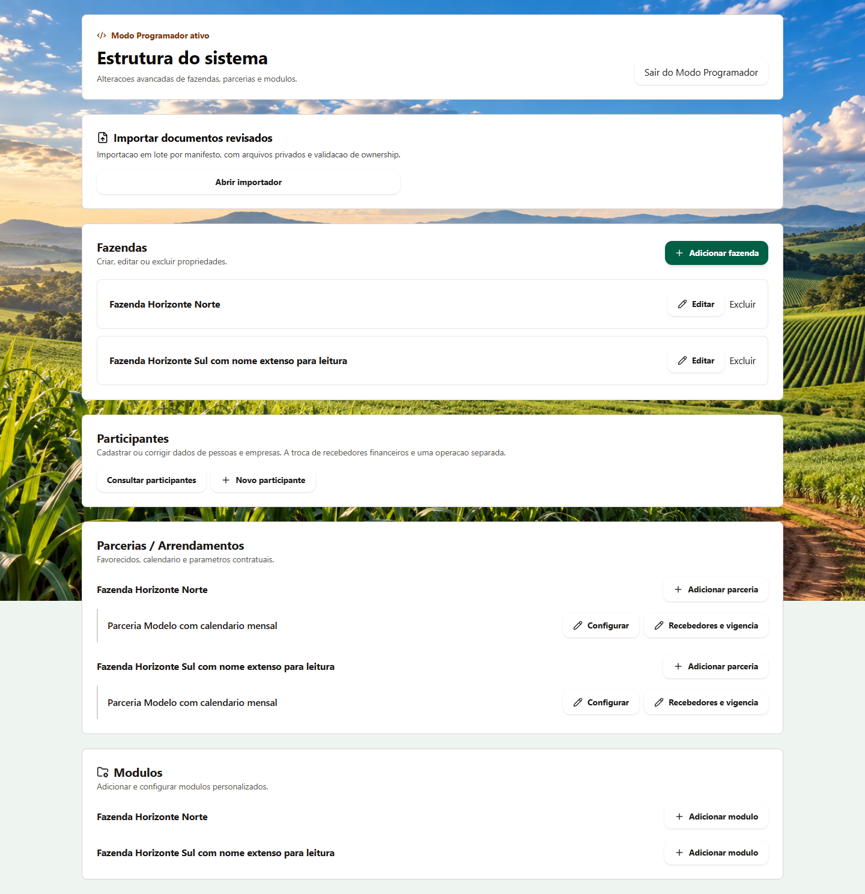

# CR Gestão Rural

**Sistema em uso operacional para gestão de propriedades e arrendamentos rurais.**

[Portfólio de Pedro Henrique Bertone](https://github.com/Sydenci#projetos) · [Demonstração documentada](docs/demonstracao.md) · [Contato profissional](https://www.linkedin.com/in/pedro-bertone-0890822b5/)

## O problema

Propriedades, participantes e regras de pagamento precisam continuar relacionados quando um cadastro muda ou um vínculo é encerrado. O sistema organiza essas informações e mantém a referência das regras financeiras utilizadas em cada competência.

## A solução

- Cadastro de propriedades e participantes, consulta de fichas e manutenção de vínculos ativos ou encerrados.
- Configuração de parcerias e arrendamentos com recebedores, divisão contratual e vencimentos individuais.
- Ciclos mensais ou anuais e versionamento das regras por mês de vigência.
- Preservação da versão utilizada na geração de cada competência.
- Relatórios por competência e geração de fichas de propriedades em PDF.

## Minha participação

Atuo na concepção e no desenvolvimento da solução, com definição de requisitos, organização das funcionalidades, testes e aprimoramento do sistema. Utilizo ferramentas de inteligência artificial para apoiar a implementação e a evolução do projeto.

## Demonstração

*Área administrativa demonstrativa. As propriedades e os participantes utilizados nas capturas são fictícios.*

[Ver as quatro capturas e seus contextos](docs/demonstracao.md)

## Tecnologias do projeto

Next.js · TypeScript · PostgreSQL · Supabase · Expo

O projeto reúne aplicação web e aplicativo móvel. As capturas deste portfólio documentam a interface web, incluindo uma visualização em tela estreita.

## Sobre este repositório

Repositório público de apresentação do projeto. O conteúdo publicado é composto por documentação e imagens demonstrativas. A aplicação e seu código-fonte têm distribuição privada.

**Autoria — Pedro Henrique Bertone**

[LinkedIn](https://www.linkedin.com/in/pedro-bertone-0890822b5/) · [E-mail](mailto:pedrohbertone@outlook.com)
