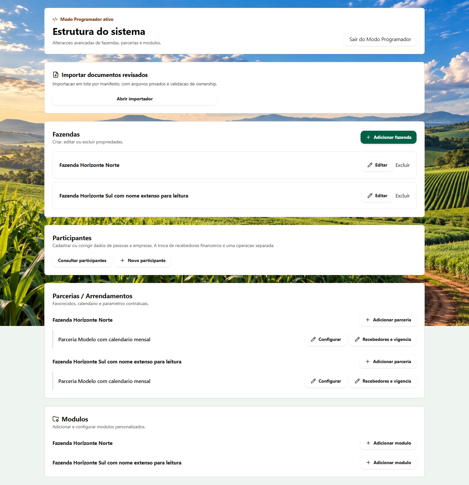
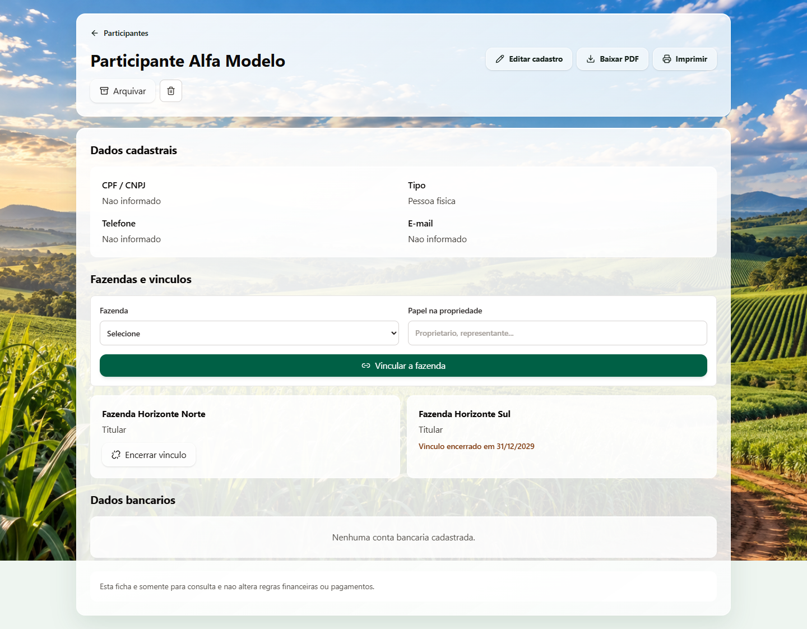
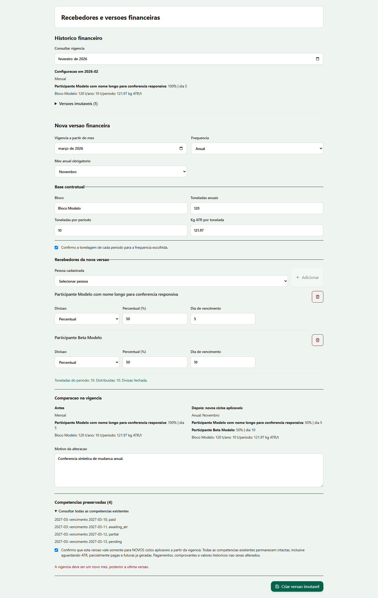
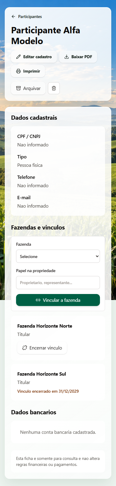

# Demonstração do CR Gestão Rural

[Voltar à apresentação](../README.md)

As capturas registram testes visuais dos componentes web com propriedades, participantes e valores fictícios. Elas ilustram os fluxos descritos no projeto em uso operacional.

## Estrutura do sistema

Área administrativa com propriedades, participantes, parcerias e módulos. Os nomes “Fazenda Horizonte” e “Parceria Modelo” identificam os dados demonstrativos.

## Ficha de participante

A ficha separa dados cadastrais e vínculos com propriedades. O exemplo permite observar um vínculo ativo e outro encerrado. Os campos de documento, contato e conta bancária estão sem dados cadastrados.

## Vigência financeira anual

O formulário apresenta a mudança de regras mensais para anuais, a divisão entre recebedores e as competências preservadas. A captura mostra o formulário em edição, com uma mensagem de validação de vigência. Esse registro documenta a conferência da regra antes do salvamento.

## Interface web em tela estreita

A ficha foi registrada com largura de 390 px. Os campos, cartões e ações são empilhados para a consulta na interface web responsiva.

## Escopo da apresentação

O catálogo aprovado documenta cadastro e consulta, manutenção de vínculos, parcerias e arrendamentos, regras financeiras com vigência, relatórios por competência e fichas em PDF. As telas demonstrativas foram selecionadas para explicar esses fluxos com dados de teste.
